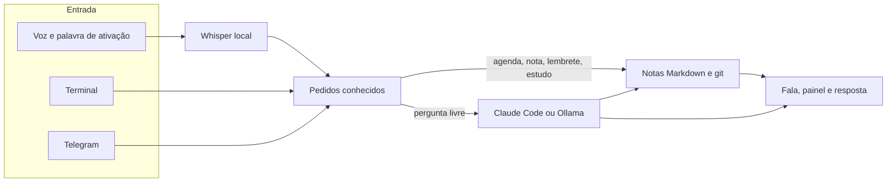

# Jarvis

Assistente de voz e de texto em português, feito para rodar na máquina de uma pessoa. O microfone vira texto com o Whisper local. Pedidos conhecidos (agenda, nota, lembrete, revisão, estudo) são resolvidos neste processo. O que sobra vai para o Claude Code já logado na conta, ou para um modelo local no Ollama. A resposta volta falada, no terminal ou no Telegram.

O repositório não traz notas pessoais, gravação de voz nem segredo. O vault de Markdown fica fora daqui, apontado por variável de ambiente. Gmail, Jira e GitHub, quando configurados, entram só para leitura. O Jarvis não envia e-mail.

## O que faz

- Ouve uma palavra de ativação e transcreve a fala neste computador.
- Conversa por texto no terminal e, se você quiser, por um bot de Telegram restrito a um usuário.
- Lê e grava um vault de notas em Markdown (no estilo do Obsidian) e sincroniza esse clone com git, sem push forçado.
- Mantém agenda, lembretes, revisão espaçada, sessão de estudo e um painel local em `127.0.0.1`.
- Pode consultar issues, pull requests e e-mail importante, sem alterar nada nesses serviços.

## Arquitetura



A palavra de ativação fica em standby. O terminal pula o microfone. Uma nota de voz no Telegram passa pelo mesmo Whisper. O painel e a consulta do vault escutam só em loopback. Nota marcada como sigilosa, ou dentro de uma pasta privada, não sai para a nuvem nem para o Telegram.

## Stack

- Python 3.11 ou mais novo.
- faster-whisper, sounddevice e edge-tts para transcrição e fala. No macOS a voz padrão pode ser a do sistema. No Windows, a neural do Edge ou o SAPI.
- openWakeWord para a palavra de ativação. No Linux com Python 3.12 ou 3.13 o pacote completo não entra pelo `requirements.txt`, porque falta wheel do tflite-runtime. Os arquivos `requirements-wake-deps.txt` e `requirements-wake.txt` cobrem o caminho ONNX.
- Claude Code no PATH, usado em modo headless com a sessão da pessoa. Não há chave de API versionada.
- Ollama opcional, em `127.0.0.1`, para pergunta simples.
- Vault: pasta de Markdown com git. O formato das pastas é lido do `AGENTS.md` do próprio clone.
- Telegram, Readwise, Jira, GitHub CLI e Gmail IMAP são opcionais.
- Pacotes opcionais de captura: youtube-transcript-api, trafilatura, pypdf e sentence-transformers.

## Como rodar

No Linux ou no macOS, na pasta do repositório:

```bash
python3 -m venv .venv
source .venv/bin/activate
pip install -r requirements.txt
mkdir -p ~/.jarvis
cp .env.example ~/.jarvis/.env
```

No PowerShell:

```powershell
Set-ExecutionPolicy -ExecutionPolicy RemoteSigned -Scope CurrentUser
.\scripts\instalar.ps1
copy .env.example $env:USERPROFILE\.jarvis\.env
```

O atalho equivalente no Linux e no macOS é `./scripts/instalar.sh`. Para incluir a palavra de ativação, use `--wake` ou `-Wake`.

Edite `~/.jarvis/.env` e aponte `JARVIS_VAULT` para um clone local de notas. Esse arquivo não entra no git. Variável que já existe no ambiente não é coberta pelo arquivo. Sem microfone, `python -m jarvis.chat` conversa no terminal. Com microfone, `python -m jarvis.main`. O diagnóstico é `python -m jarvis.doctor`.

A suíte não baixa modelo e não usa microfone:

```bash
pip install -r requirements-dev.txt
python -m unittest discover -s tests -t .
python -m ruff check jarvis tests
```

## Instalação guiada

Com o ambiente virtual ativo:

```bash
python -m jarvis.setup
```

O instalador confere o Python, oferece o que falta e grava as chaves em `~/.jarvis/.env`. Enter mantém o valor atual. Em chave secreta, o valor não aparece enquanto você digita. `limpar` apaga uma chave. Não existe repositório de notas padrão: ou você aponta um clone que já existe, ou define `JARVIS_VAULT_REMOTE` para o instalador clonar o seu.

No fim ele pode armar o início no login: tarefa `Jarvis` no Windows, ou LaunchAgent no macOS. Para desligar: `python -m jarvis.setup --desativar-inicio`.

## Instalação manual

```bash
python -m venv .venv
source .venv/bin/activate
pip install -r requirements.txt
mkdir -p ~/.jarvis
cp .env.example ~/.jarvis/.env
python -m jarvis.doctor
python -m jarvis.chat
```

No Windows, ative com `.venv\Scripts\activate` e copie o exemplo para `%USERPROFILE%\.jarvis\.env`.

## Comandos

A ajuda falada (`ajuda`) e o `/ajuda` do terminal e do Telegram saem desta lista. Explicação, pergunta socrática, revisão semanal, teste falado, sessão de estudo e confirmação aceitam `cancela` e `para`.

### Conversa

- Apaga o contexto da conversa atual e encerra modo ou confirmação. Exemplo: `nova conversa`.
- Encerra o assunto. cancela ou para interrompe explicação, teste ou confirmação. Exemplo: `Valeu, Jarvis`.
- Repete o que você pediu hoje, ontem ou anteontem. Exemplo: `o que eu te pedi ontem?`.
- Lista estes pedidos. Exemplo: `ajuda`.
- Explica como apontar o vault na primeira vez. Exemplo: `primeiro uso`.
- Pergunta livre, respondida pelo cérebro. Exemplo: `o que tenho no laboratorio?`.

### Notas

- Guarda a última resposta numa nota. Exemplo: `salva isso`.
- Anota um fato no diário ou numa pasta do vault. Exemplo: `anota que comprar pão`.
- Busca a transcrição de um vídeo do YouTube, com o pacote opcional youtube-transcript-api, em português e depois em inglês, e grava resumo, pontos e cartões em rascunho. Exemplo: `salva esse vídeo https://www.youtube.com/watch?v=Abcdefghijk`.
- Busca o texto de um artigo, com o pacote opcional trafilatura, e grava resumo, pontos e cartões em rascunho. Exemplo: `salva esse artigo https://exemplo.test/nota`.
- Grava o resumo de um episódio a partir de um endereço ou de um arquivo de transcrição. Exemplo: `salva esse podcast https://exemplo.test/episodio.txt`.
- Busca a transcrição de um vídeo do YouTube, em português e depois em inglês, e grava uma nota de estudo com resumo, ideias com tempo, citações e perguntas. Uma nota por vídeo. Exemplo: `resume esse vídeo https://www.youtube.com/watch?v=Abcdefghijk`.
- Transcreve um áudio local com o Whisper desta máquina, em trechos, e grava a mesma nota de estudo. O áudio não sai da máquina. Exemplo: `resume esse áudio episodio-sintetico.mp3`.
- Processa áudios e links.txt da pasta de entrada, com confirmação, e grava uma nota de estudo por item. Exemplo: `processa minha fila de mídia`.
- Procura nas notas, nos livros, nos vídeos e nos cursos. Exemplo: `o que eu escrevi sobre o farol?`.
- Responde o que as notas cobrem sobre uma pergunta, só com trechos recuperados, e cita o título. Exemplo: `o que minhas notas dizem sobre o farol?`.

### Agenda

- Marca uma tarefa da agenda como feita. Exemplo: `marca como feito pagar a conta de luz`.
- Adia um lembrete já gravado. Exemplo: `adia o lembrete de pagar o boleto para amanhã às 10`.
- Cancela um lembrete. Exemplo: `cancela o lembrete de pagar o boleto`.
- Cria um lembrete com dia, hora ou repetição. Exemplo: `Me lembra de pagar o boleto amanha as 9`.
- Resume o dia: agenda, lembretes e tarefas. Exemplo: `bom dia`.
- Lista a agenda de hoje, de amanhã ou de depois de amanhã. Exemplo: `o que tenho hoje`.
- Resume a semana que passou. Exemplo: `como foi minha semana?`.
- Resume o dia e oferece gravar. Exemplo: `como foi meu dia`.
- Diz as prioridades do dia. Exemplo: `quais minhas prioridades hoje?`.

### Memória

- Guarda um fato estável sobre você. Exemplo: `lembra que eu gosto de café sem açúcar`.
- Lê a nota da persona, sem mandar o texto para a nuvem. Exemplo: `Mostra sua persona.`.
- Lista as fontes declaradas na persona. Exemplo: `Quais fontes tenho?`.
- Diz o que está guardado sobre você. Exemplo: `o que você sabe sobre mim?`.
- Apaga um fato da memória, com confirmação. Exemplo: `Esquece que eu gosto de café`.

### Estudo

- Importa destaques do Readwise para o vault. Exemplo: `importa meus destaques`.
- Importa destaques do Kindle, de PDF ou do KOReader para uma nota por livro. Pede confirmação e não repete destaque. Exemplo: `importa destaques do kindle`.
- Conta o que entrou nas notas nesta semana. Exemplo: `o que aprendi esta semana?`.
- Me testa sobre um tema dos livros, vídeos ou cursos. Exemplo: `Me testa sobre a fita nos livros.`.
- Lista notas ligadas a um tema, com título e caminho. Exemplo: `Notas relacionadas ao farol.`.
- Acha notas de fontes diferentes sobre o mesmo assunto e sugere um mapa. Gravar ou ligar pede confirmação. Exemplo: `conecta ideias`.
- Traz o título de uma nota antiga e um ponto que você escreveu. Nota privada fica de fora. Exemplo: `me lembra algo`.
- Guarda uma meta, mostra o que o vault já tem e sugere um plano da semana. Exemplo: `quero aprender farol`.
- Conta a revisão espaçada dos cartões ligados a um tema. Exemplo: `como estou em farol?`.
- Conta a revisão, as sessões de estudo, o acerto e as notas públicas desta semana. Exemplo: `quanto estudei essa semana?`.
- Começa uma sessão de estudo, no estilo Pomodoro, com pausa configurável. O padrão é 25 minutos. Exemplo: `começa uma sessão de estudo de 25 minutos sobre farol`.
- Diz quanto falta da sessão de estudo ou da pausa. Exemplo: `quanto falta?`.
- Pausa a sessão de estudo. A palavra para, sozinha, encerra o modo. Exemplo: `pausa`.
- Retoma a sessão de estudo que estava pausada. Exemplo: `continua a sessão`.
- Encerra a sessão, avisa e pergunta o que você aprendeu. cancela ou para só encerra. Exemplo: `encerra a sessão`.
- Diz há quantos dias seguidos houve revisão ou sessão de estudo. Exemplo: `qual minha sequência?`.
- Pede confirmação e grava os cartões públicos num texto para o Anki, fora do vault. Exemplo: `exporta meus cartões`.
- Pede uma explicação com palavras simples, compara com as notas e oferece cartões em rascunho para as lacunas. Exemplo: `me deixa explicar farol`.
- Faz perguntas de por que e de como, uma por vez, a partir das notas. Exemplo: `me pergunta sobre farol`.
- Conduz a revisão semanal e, depois da confirmação, grava a nota da semana. Exemplo: `revisão semanal`.
- Abre a revisão do dia, no formato pergunta e resposta. Exemplo: `revisão do dia`.
- Limita a revisão a um livro. Exemplo: `me pergunta sobre o livro foguete`.
- Interrompe a revisão. Exemplo: `pausa a revisão`.
- Continua a revisão pausada. Exemplo: `retoma a revisão`.
- Registra acerto ou erro do cartão. Difícil, bom e fácil também entram na revisão. Exemplo: `acertei`.
- Lista os cartões em rascunho criados por uma captura, antes da revisão espaçada. Exemplo: `revisa rascunhos`.
- Aceita um cartão em rascunho para ele entrar na revisão espaçada. Exemplo: `aceita o rascunho`.
- Apaga um cartão em rascunho. Exemplo: `descarta o rascunho`.
- Troca a pergunta e a resposta de um cartão em rascunho. Exemplo: `edita o rascunho Qual a cor da fita? ::: azul`.

### Integrações

- Lê issues do Jira. Não altera nada. Exemplo: `o que tenho no Jira?`.
- Lê pull requests. Não comenta nem faz merge. Exemplo: `como estão meus PRs?`.
- Lê e-mail importante. O Jarvis não envia e-mail. Exemplo: `tenho e-mail importante?`.

### Assistentes

- Resume os recados dos outros assistentes. Exemplo: `resume os recados`.
- Lê o que os assistentes mandaram. Exemplo: `o que os assistentes mandaram?`.
- Deixa um pedido para outro assistente. Exemplo: `pede pro Codex revisar o PR`.

### Avisos

- Calar o último aviso até o fim do dia. Exemplo: `silencia esse aviso hoje`.
- Calar esse tipo de aviso nas próximas vezes. Exemplo: `silencia sempre`.
- Adia os avisos até amanhã. Exemplo: `pausa os alertas até amanhã`.

### Privacidade

- Desliga a nuvem, o Telegram e o log nesta sessão. Exemplo: `modo privado`.
- Volta a usar a nuvem, o Telegram e o log. Exemplo: `sai do modo privado`.

### Telegram

- Desliga o Telegram até o fim do dia. No celular, /sair faz o mesmo. Exemplo: `desliga o telegram hoje`.

### Manutenção

- Diz a versão desta instalação. Exemplo: `qual sua versão?`.
- Pede confirmação e atualiza só o código do Jarvis. O vault fica de fora. Exemplo: `se atualiza`.

## De qualquer lugar

Com o computador ligado, `python -m jarvis.main` ouve, fala e também atende o Telegram, os lembretes e os check-ins. `python -m jarvis.telegram` sobe só esse companheiro, sem microfone. `python -m jarvis.chat` conversa no terminal.

O Telegram pede `TELEGRAM_BOT_TOKEN` e `TELEGRAM_ALLOWED_USER_ID`. Sem o ID, o bot não conecta. Outro chat é recusado. Nota sigilosa ou em pasta privada não sai no Telegram. Não compartilhe o token.

## Diagnóstico

```bash
python -m jarvis.doctor
python -m jarvis.doctor --corrigir
```

O diagnóstico confere Python, dependências, ambiente, Claude logado, vault, Telegram, microfone, voz e portas. Não imprime token nem senha. `--corrigir` só faz o que é seguro sozinho: cria o arquivo de ambiente vazio, restringe a permissão e instala dependência faltante. Login do Claude, clone do vault e permissão de microfone continuam com você.

## Versão, atualização e relatório

```bash
python -m jarvis --versao
python -m jarvis atualizar
python -m jarvis relatorio
```

`atualizar` puxa o código deste repositório com `git pull --ff-only`. Não mexe no vault. `relatorio` grava um zip com o diagnóstico, a versão, os nomes das configurações sem os valores e as últimas linhas do log sem o texto. Não entra nota nem segredo.

No Windows, `.\scripts\testar-windows.ps1` roda a suíte, o diagnóstico, o benchmark e um smoke dos comandos. Não lê nota e não envia e-mail.

## Configuração

O padrão vale quando a variável não existe. Segredo fica só no `~/.jarvis/.env`. O exemplo versionado é `.env.example` (o mesmo conteúdo está em `.env.exemplo`).

| Variável | Padrão | Descrição |
|---|---|---|
| `JARVIS_HOME` | `~/.jarvis` | Pasta local de log, estado e revisão. |
| `JARVIS_ENV_FILE` | `~/.jarvis/.env` | Arquivo de ambiente. Variável que já existe no processo não é coberta. |
| `JARVIS_VAULT` | `vazio` | Clone local do vault. Vazio desliga a leitura das notas. |
| `JARVIS_PASTAS_PRIVADAS` | `vazio` | Pastas relativas do vault, separadas por vírgula, que não saem desta máquina. |
| `JARVIS_PASTAS_IGNORADAS` | `vazio` | Pastas do vault, separadas por vírgula, fora da busca, dos cartões e dos lembretes. Não é sigilo: o Claude continua lendo essas pastas. |
| `JARVIS_TAG_SIGILOSA` | `sigiloso` | Tag de nota que fica só no modelo local. |
| `JARVIS_VAULT_SYNC` | `on` | off usa o vault sem pull, commit ou push. |
| `JARVIS_VAULT_REMOTE` | `vazio` | Remoto git esperado. Vazio aceita o origin do clone. Se preenchido, outro destino é recusado. HTTPS e SSH do mesmo repositório contam igual. |
| `JARVIS_VAULT_BRANCH` | `vazio` | Se definida, o clone já precisa estar nessa branch. |
| `JARVIS_VAULT_GIT_TIMEOUT` | `120` | Segundos de cada comando git do sync. |
| `JARVIS_DOCTOR_GIT_TIMEOUT` | `10` | Segundos da checagem de remoto no diagnóstico. |
| `JARVIS_GIT_BIN` | `git` | Executável do git, nome no PATH ou caminho completo. |
| `JARVIS_CLAUDE_BIN` | `claude` | Executável do Claude Code. |
| `JARVIS_GH_BIN` | `gh` | Executável do GitHub CLI. A consulta de PR é só leitura. |
| `JARVIS_MODEL` | `vazio` | Modelo do Claude. Vazio usa o padrão da conta. |
| `JARVIS_WORKSPACE` | `./workspace` | Pasta de trabalho quando o vault não está configurado. |
| `JARVIS_PROMPT_FILE` | `./workspace/prompt-vault.md` | Arquivo do prompt montado fora do vault. |
| `JARVIS_ALLOWED_TOOLS` | `Read,Glob,Grep,WebSearch,WebFetch` | Ferramentas do Claude, separadas por vírgula. Com vault e sem esta variável, entram Edit e Write. |
| `JARVIS_TURN_TIMEOUT` | `300` | Segundos de cada consulta ao Claude. |
| `JARVIS_LOG` | `~/.jarvis/logs/jarvis.log` | Log local rotativo, fora do vault. |
| `JARVIS_STATE` | `~/.jarvis/state.json` | Estado local dos avisos. Não guarda segredo. |
| `JARVIS_REVISAO` | `~/.jarvis/revisao.json` | Agendamento da revisão espaçada, fora do vault. |
| `JARVIS_TTS` | `auto` | Backend de voz: auto, say, edge ou sapi. |
| `JARVIS_VOICE` | `Luciana` | Voz do macOS. |
| `JARVIS_SPEECH_RATE` | `190` | Velocidade da fala do backend say. |
| `JARVIS_EDGE_VOICE` | `pt-BR-AntonioNeural` | Voz neural do backend edge. |
| `JARVIS_EDGE_RATE` | `+10%` | Velocidade da fala do backend edge. |
| `JARVIS_EDGE_TIMEOUT` | `30` | Segundos para sintetizar com o backend edge. |
| `JARVIS_SAPI_RATE` | `1` | Velocidade da fala do backend sapi, de -10 a 10. |
| `JARVIS_STT` | `auto` | faster-whisper, whisper ou auto. auto prefere o faster-whisper. |
| `JARVIS_WHISPER_MODEL` | `small` | Tamanho do modelo local: tiny, base, small ou medium. |
| `JARVIS_LANGUAGE` | `pt` | Idioma da transcrição. |
| `JARVIS_SILENCE_THRESHOLD` | `0.012` | Sensibilidade do detector de silêncio. |
| `JARVIS_SILENCE_SECONDS` | `1.2` | Pausa, em segundos, que encerra a captura. |
| `JARVIS_NO_SPEECH_SECONDS` | `6` | Segundos sem fala antes de desistir da captura. |
| `JARVIS_MAX_RECORD_SECONDS` | `60` | Duração máxima, em segundos, de uma captura. |
| `JARVIS_WAKE_MODEL` | `hey_jarvis_v0.1` | Modelo ONNX da palavra de ativação. |
| `JARVIS_WAKE_THRESHOLD` | `0.5` | Sensibilidade da palavra de ativação. |
| `JARVIS_FOLLOWUP_NO_SPEECH_SECONDS` | `4` | Segundos de continuação depois da resposta. |
| `JARVIS_NOME` | `usuario` | Nome no remetente das notas de pedido. O padrão é neutro. |
| `JARVIS_CONTEXTO` | `on` | on guarda as últimas trocas em ~/.jarvis/contexto.json. |
| `JARVIS_CONTEXTO_TURNOS` | `6` | Quantas trocas recentes acompanham o pedido seguinte. |
| `JARVIS_CONTEXTO_ARQUIVO` | `~/.jarvis/contexto.json` | Arquivo do contexto. Não leva trecho de nota. |
| `JARVIS_STREAM` | `on` | Fala a primeira frase assim que ela fecha. |
| `JARVIS_MODO_PRAZO` | `1800` | Prazo em segundos de explicação, teste ou confirmação. cancela ou para encerra. |
| `JARVIS_PANEL` | `on` | Painel local. off desliga. |
| `JARVIS_PANEL_PORT` | `8765` | Porta do painel. Não exponha fora da máquina. |
| `JARVIS_PANEL_BIND` | `127.0.0.1` | Só loopback. Outro valor é ignorado. |
| `JARVIS_PANEL_OPEN` | `on` | Abrir o navegador ao iniciar. |
| `JARVIS_BANDEJA` | `on` | off não cria o ícone da bandeja. |
| `JARVIS_CONSULT_PORT` | `8766` | Porta da consulta somente leitura. |
| `JARVIS_CONSULT_BIND` | `127.0.0.1` | 127.0.0.1 ou lan. 0.0.0.0 e IP público são recusados. |
| `JARVIS_CONSULT_MODEL` | `on` | off ignora o modelo local mesmo com os pesos em disco. |
| `JARVIS_CONSULT_MODEL_DIR` | `~/.jarvis/models/consult` | Pasta dos pesos do modelo gratuito. |
| `JARVIS_REMINDER_SECONDS` | `15` | Intervalo, em segundos, da busca de lembretes vencidos. |
| `JARVIS_CHECKIN` | `on` | off desliga o briefing e o resumo do fim do dia. |
| `JARVIS_CHECKIN_MORNING` | `on` | Briefing no primeiro arranque do dia. |
| `JARVIS_CHECKIN_EVENING` | `on` | Resumo do fim do dia, com oferta de gravar. |
| `JARVIS_CHECKIN_EVENING_AT` | `18:30` | Horário local do resumo, HH:MM. |
| `JARVIS_RADAR` | `on` | off desliga os alertas de PR, Jira e e-mail. Só leitura. |
| `JARVIS_RADAR_SECONDS` | `300` | Intervalo, em segundos, da consulta somente leitura. |
| `JARVIS_RADAR_COOLDOWN` | `900` | Segundos mínimos entre um aviso e outro. |
| `JARVIS_REVISAO_LIMITE` | `10` | Cartões da revisão por dia, entre 1 e 50. |
| `JARVIS_REVISAO_NOVOS` | `5` | Cartões novos por dia, entre 0 e 50. O limite do dia continua valendo. |
| `JARVIS_REVISAO_PRIORIDADE` | `vazio` | Pastas ou tags, separadas por vírgula. Esses cartões entram primeiro. |
| `JIRA_URL` | `vazio` | Endereço do Jira. O Jarvis só lê issues. |
| `JIRA_EMAIL` | `vazio` | E-mail da conta Atlassian. Só leitura. |
| `JIRA_TOKEN` | `vazio` | Token de API do Jira. Só leitura. Não commite. |
| `GMAIL_EMAIL` | `vazio` | Conta Gmail lida por IMAP. O Jarvis não envia e-mail. |
| `GMAIL_APP_PASSWORD` | `vazio` | Senha de app do Gmail. Não envia e-mail. Não commite. |
| `GMAIL_IMAP_HOST` | `imap.gmail.com` | Servidor IMAP. |
| `GMAIL_IMAP_PORT` | `993` | Porta IMAP. |
| `TELEGRAM_BOT_TOKEN` | `vazio` | Token do bot. Vazio desliga. Não commite. |
| `TELEGRAM_ALLOWED_USER_ID` | `vazio` | ID numérico do único usuário. Sem ele o bot não conecta. |
| `TELEGRAM_VOICE_REPLY` | `off` | on também envia a resposta em áudio. |
| `TELEGRAM_CHAT_ID` | `vazio` | ID numérico da conversa privada. Vazio usa o ID do usuário. Outro chat é recusado. |
| `TELEGRAM_LIMITE` | `20` | Mensagens por minuto no Telegram, entre 1 e 60. |
| `READWISE_TOKEN` | `vazio` | Token do Readwise. Só baixa destaque. Não commite. |
| `JARVIS_READWISE_PASTA` | `Leituras/Readwise` | Pasta do clone para cada livro ou artigo. |
| `JARVIS_DESTAQUES_PASTA` | `Leituras/Destaques` | Pasta do clone para uma nota por livro importado do Kindle, PDF ou KOReader. |
| `JARVIS_DESTAQUES_ENTRADA` | `~/.jarvis/destaques` | Pasta de entrada de My Clippings, PDF e exportação do KOReader. Fora do vault. |
| `JARVIS_LIVROS_PASTA` | `Tecnologia/Livros` | Pasta dos livros. A busca nos livros usa este caminho. |
| `JARVIS_VIDEOS_PASTA` | `Tecnologia/Vídeos` | Pasta do vault para o resumo de um vídeo do YouTube. |
| `JARVIS_CURSOS_PASTA` | `Tecnologia/Cursos` | Pasta dos cursos. A busca nos cursos usa este caminho. |
| `JARVIS_ARTIGOS_PASTA` | `Tecnologia/Artigos` | Pasta do vault para o resumo de um artigo. |
| `JARVIS_PODCASTS_PASTA` | `Tecnologia/Podcasts` | Pasta do vault para o resumo de um episódio. |
| `JARVIS_ESTUDO_MIDIA_PASTA` | `Estudos/Mídia` | Pasta da nota de estudo de um vídeo ou áudio. Uma nota por vídeo. |
| `JARVIS_MIDIA_ENTRADA` | `~/.jarvis/midia` | Pasta de entrada de áudio e de links.txt, fora do vault. A fila pede confirmação. |
| `JARVIS_CAPTURA_CARTOES` | `on` | off grava o resumo sem cartões em rascunho. |
| `JARVIS_DIGEST` | `off` | on envia o que aprendi esta semana no Telegram, no domingo. |
| `JARVIS_DIGEST_AT` | `18:30` | Horário desse envio. Vazio segue o check-in da tarde. |
| `JARVIS_BRIEFING_TELEGRAM` | `off` | on envia o bom dia no Telegram, uma vez por dia. |
| `JARVIS_BRIEFING_HORA` | `07:30` | Horário local desse envio, HH:MM. |
| `JARVIS_LEMBRETE_NOTA` | `off` | on envia no Telegram, uma vez por dia, o título de uma nota antiga e um ponto seu. Nota privada fica de fora. |
| `JARVIS_LEMBRETE_NOTA_HORA` | `08:00` | Horário local desse lembrete de nota, HH:MM. O padrão é desligado. |
| `JARVIS_REVISAO_SEMANAL` | `off` | on lembra no Telegram, no domingo, de começar a revisão semanal. Não manda texto de nota. O padrão é desligado. |
| `JARVIS_REVISAO_SEMANAL_HORA` | `10:00` | Horário local desse lembrete de domingo, HH:MM. Só vale com JARVIS_REVISAO_SEMANAL=on. |
| `JARVIS_TOQUE_SEQUENCIA` | `off` | on manda no Telegram, à noite, um aviso se não houve revisão no dia. Não leva texto de nota. O padrão é desligado. |
| `JARVIS_TOQUE_SEQUENCIA_HORA` | `20:00` | Horário local desse aviso, HH:MM. Só vale com JARVIS_TOQUE_SEQUENCIA=on. |
| `JARVIS_SESSAO_TELEGRAM` | `off` | on avisa no Telegram quando a sessão de estudo acaba. Não leva texto de nota nem o que você aprendeu. O padrão é desligado. |
| `JARVIS_SESSAO_SILENCIO` | `on` | on adia briefing, lembrete e resumo enquanto a sessão de estudo está em andamento. off deixa esses avisos passarem. |
| `JARVIS_PERSONA` | `Jarvis/Persona.md` | Nota da persona, relativa ao clone e fora de .obsidian. |
| `JARVIS_CEREBRO` | `claude` | claude é o padrão. ollama atende pergunta simples. |
| `JARVIS_OLLAMA_URL` | `http://127.0.0.1:11434` | Endereço do Ollama, sem usuário nem senha na URL. |
| `JARVIS_OLLAMA_MODEL` | `llama3.2` | Modelo local quando JARVIS_CEREBRO=ollama. |
| `JARVIS_OLLAMA_TIMEOUT` | `20` | Segundos da resposta local. |
| `JARVIS_SESSAO_MINUTOS` | `25` | Minutos da sessão de estudo quando o pedido não diz o tempo. Entre 1 e 180. |
| `JARVIS_SESSAO_PAUSA` | `5` | Minutos de pausa depois da sessão, no estilo Pomodoro. 0 desliga a pausa. Entre 0 e 60. |
| `JARVIS_SESSAO_NOTA` | `meta` | meta anexa o que você aprendeu na nota do tema. diario anexa na nota do dia. Só depois do sim. |
| `JARVIS_SESSAO_PASTA` | `Estudos/Sessoes` | Pasta da nota do tema quando ainda não existe nota de meta. |
| `JARVIS_ESTUDO_LIMITE` | `3` | Cartões de me testa sobre, entre 1 e 8. |
| `JARVIS_METAS_VAULT` | `off` | on também grava a meta de quero aprender numa nota do vault. O padrão fica só em ~/.jarvis. |
| `JARVIS_METAS_PASTA` | `Estudos/Metas` | Pasta da nota de meta quando JARVIS_METAS_VAULT=on. |
| `JARVIS_MAPAS_PASTA` | `Estudos/Mapas` | Pasta do mapa de conteúdo gravado depois da confirmação de conecta ideias. |
| `JARVIS_REVISAO_SEMANAL_PASTA` | `Diario/Revisao` | Pasta da nota revisao-semanal-AAAA-Www.md, gravada depois da confirmação. |
| `JARVIS_ESTUDO_CEREBRO` | `off` | on pede ao cérebro só quando a resposta fica parecida. |
| `JARVIS_INDICE` | `indice.md` | Nota de índice no clone. off desliga. |
| `JARVIS_BUSCA` | `palavras` | palavras, semantica ou hibrida. O padrão é palavras e a busca não muda. semantica e hibrida usam embeddings só nesta máquina, gravados em ~/.jarvis. |
| `JARVIS_SKIP_HARDWARE` | `vazio` | 1 pula a checagem de microfone. Útil sem placa de áudio. |
| `JARVIS_ATUALIZAR` | `on` | off recusa a atualização do código. O vault não entra nessa atualização. |
| `JARVIS_ATUALIZAR_TIMEOUT` | `120` | Segundos do git pull do código. Não vale para o vault. |
| `JARVIS_RELATORIO_LINHAS` | `40` | Linhas finais do log no relatório, sem o texto da mensagem. |
| `JARVIS_RELATORIO_PASTA` | `vazio` | Pasta do zip de diagnóstico. Vazia usa a pasta do usuário. |

## Limitações

- A voz precisa de microfone. Sem ele, o modo texto continua valendo.
- A palavra de ativação no Linux com Python 3.12 ou 3.13 não instala pelo `requirements.txt` sozinho.
- O cérebro padrão depende do Claude Code instalado e logado. Sem o executável no PATH, uma pergunta livre tenta responder com as notas locais e explica o que falta.
- A voz neural do Edge usa a rede. `say` no macOS e SAPI no Windows falam offline.
- Não há vault de exemplo com as suas notas. `JARVIS_VAULT` vazio desliga a leitura. `JARVIS_VAULT_REMOTE` vazio aceita o `origin` do clone. Preenchido, recusa outro destino.
- Gmail, Jira e GitHub são opcionais e somente leitura.
- O painel (`8765`) e a consulta (`8766`) escutam em `127.0.0.1`. Não publique essas portas.
- Um processo atende uma pessoa. Não é um serviço multiusuário.
- A busca semântica é opcional, local, e fica desligada no padrão (`JARVIS_BUSCA=palavras`).
- Este texto não traz número de acerto, latência nem tamanho de vault. O que o código mede na sua máquina sai em `python -m jarvis.benchmark`, num vault sintético.

## Vault do Obsidian

O Jarvis lê e escreve no clone local. Antes de um pedido que altera nota, ele sincroniza com o git e, no fim, faz commit só do que ele mudou. Não há push forçado. A pasta `.obsidian` fica de fora.

`python -m jarvis.setup` grava `JARVIS_VAULT`. Se `JARVIS_VAULT_REMOTE` estiver vazio, ele não clona um repositório embutido. Confira com `python -m jarvis.doctor`.

`JARVIS_PASTAS_IGNORADAS` tira pastas da busca, dos cartões e dos lembretes. Não é sigilo: o modelo de nuvem continua podendo ler essas pastas. Pasta privada e a tag `#sigiloso` é que não saem da máquina.

## Diferenças entre plataformas

A voz é o que muda. O resto é o mesmo.

| | macOS | Windows |
|---|---|---|
| Voz padrão | `say` (Luciana) | `edge-tts` (Antônio) |
| Alternativa | `edge-tts` | SAPI pelo PowerShell |
| Palavra de ativação e Whisper | iguais | iguais |

`edge-tts` precisa de internet. `say` e `sapi` funcionam offline. Force um deles com `JARVIS_TTS`.
